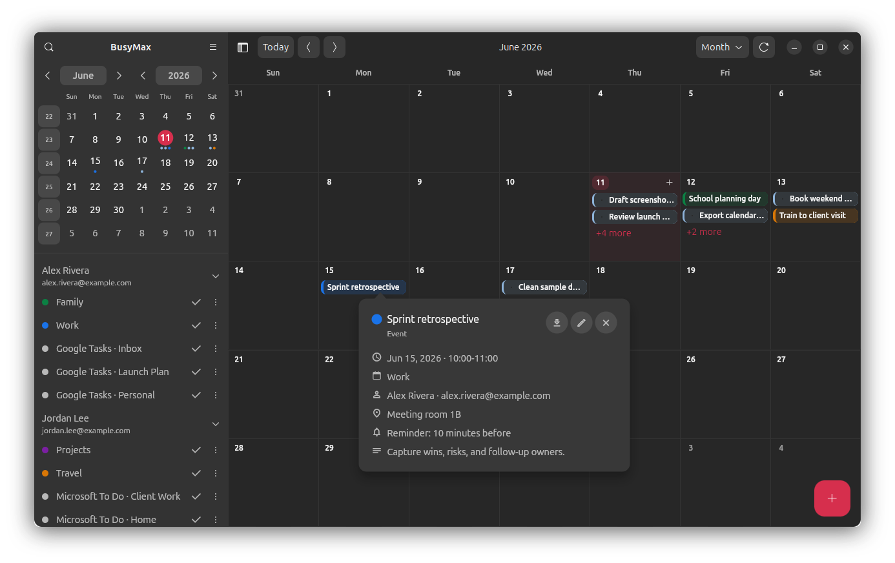
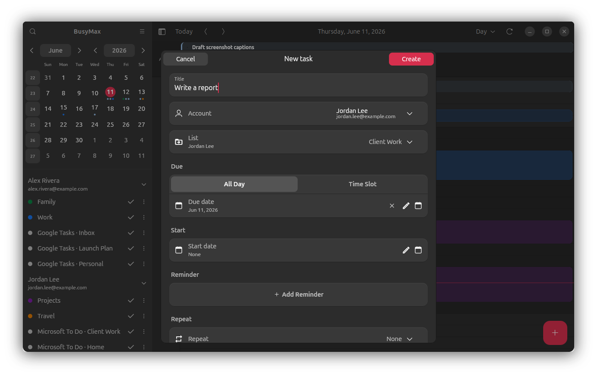
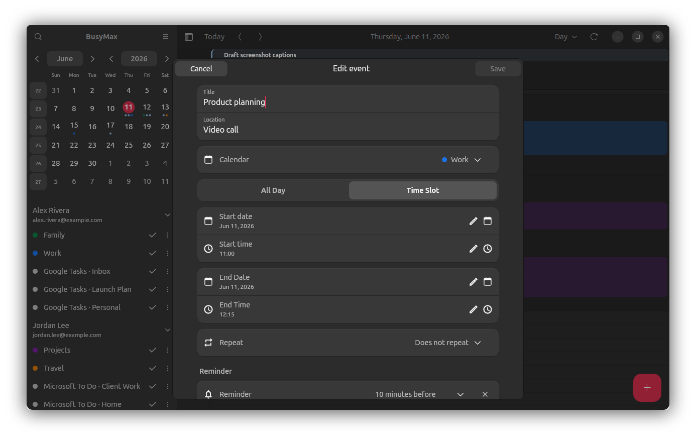
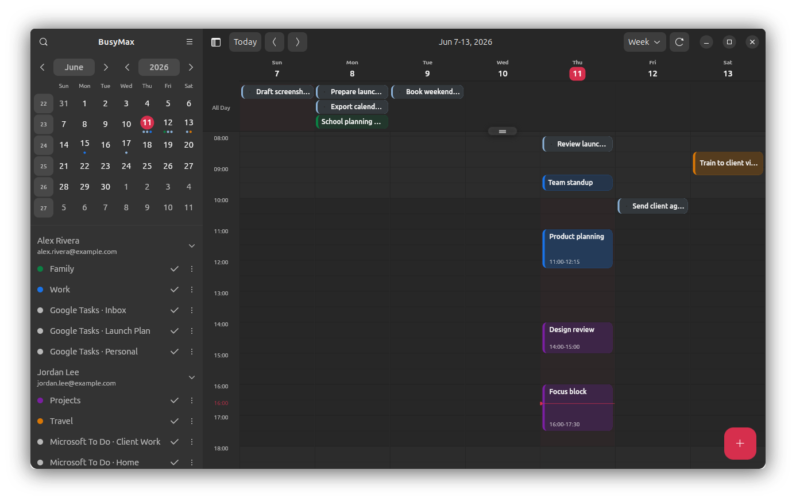
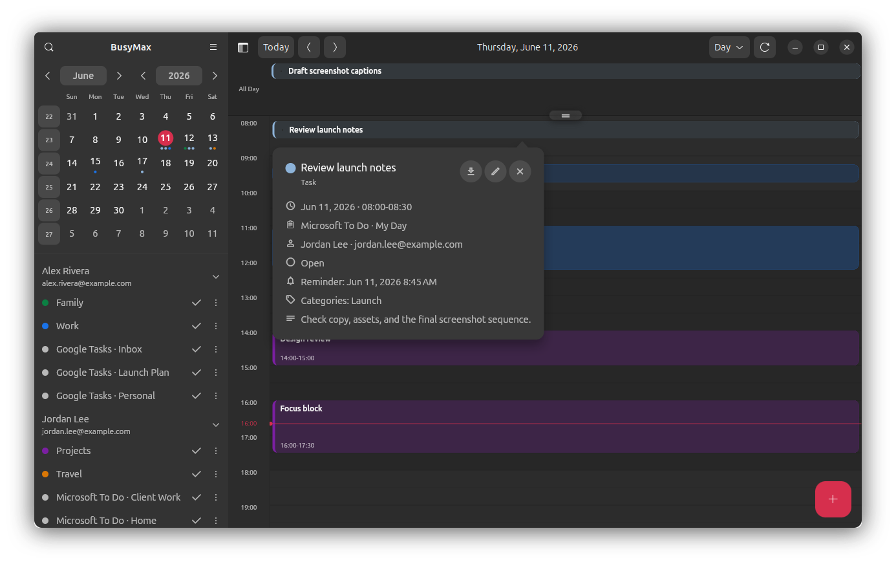
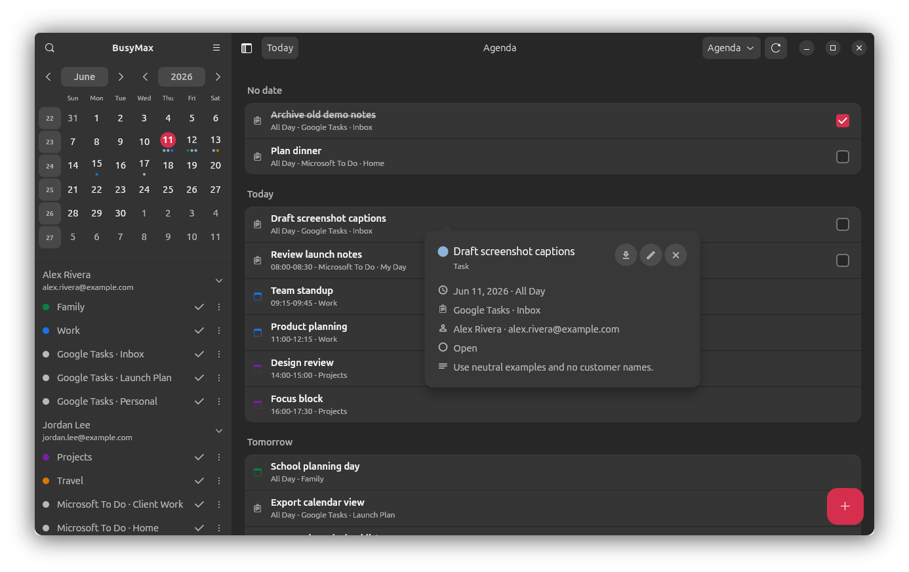
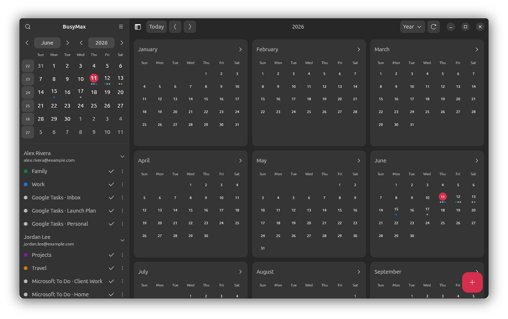

# BusyMax

[](https://snapcraft.io/busymax)

An open-source calendar and task manager for Linux, Windows, and Android.

The project is in beta. Linux releases are available through
the [Snap Store](https://snapcraft.io/busymax). Windows and Android can be built from source.

<p align="center">
  
</p>

## Providers

BusyMax supports the following calendar and task services:

- **Nextcloud Calendar and Tasks** — Dedicated integration with browser-based
  authentication. [Setup](docs/nextcloud_setup.md).
- **CalDAV** — Standards-based integration with compatible calendar and task servers, tested with
  Radicale and
  Baïkal. [Setup](docs/caldav_setup.md) · [Interoperability qualification](docs/caldav_qualification.md).
- **Google Calendar and Google Tasks**.
- **Microsoft Outlook Calendar and Microsoft To Do**.
- **Apple iCloud Calendar** — Apple Reminders is not supported. [Setup](docs/apple_icloud_setup.md).
- **WebCal** — Read-only calendar subscriptions.

Nextcloud and generic CalDAV are separate integrations. Available operations, task fields, and
editing permissions depend on the provider and collection capabilities.

See the [provider support matrix](docs/provider_support_matrix.md) for supported operations and
limitations.

Google and Microsoft authentication require appropriate OAuth configuration in the build. Developers
can consult the [Google](docs/google_setup.md) and [Microsoft](docs/microsoft_setup.md) registration
guides.

## Features

- **Calendars:** Multiple calendars, day, week, month, year and agenda views, search and filtering.
- **Events:** Recurrence, exceptions, time zones, all-day events, alarms, attendees and availability checking.
- **Tasks:** Task lists, subtasks, priorities, start and due dates, recurring tasks, completion status and progress tracking.
- **Reminders:** System notifications, snooze, dismiss, quiet hours and optional daily task summaries.
- **Synchronization:** Local caching, offline access, queued changes and conflict handling.
- **Management:** Calendar and task-list administration, sharing, and iCalendar import/export.

Capabilities and editing permissions vary by provider. See the [provider support matrix](docs/provider_support_matrix.md).

<table>
  <tr>
    <td><br><sub>Task editor</sub></td>
    <td><br><sub>Event editor</sub></td>
  </tr>
</table>

## Views

BusyMax provides day, week, month, year, and agenda views with calendar events and tasks.

<table>
  <tr>
    <td><br><sub>Week view</sub></td>
    <td><br><sub>Day view</sub></td>
  </tr>
  <tr>
    <td><br><sub>Agenda view</sub></td>
    <td><br><sub>Year view</sub></td>
  </tr>
</table>

## Build from source

BusyMax requires Flutter **3.47.5** and its bundled Dart **3.13.4** SDK.

The project also depends on three separately maintained repositories:

- [busystack_contacts](https://github.com/busystack/busystack_contacts)
- [busystack_dav](https://github.com/busystack/busystack_dav)
- [busystack_graph](https://github.com/busystack/busystack_graph)

Their required revisions are defined in [
`tool/shared_dependencies.json`](tool/shared_dependencies.json). The checkout script retrieves and
verifies them in sibling directories.

From the repository root:

```sh
python3 tool/checkout_shared_dependencies.py
flutter pub get --enforce-lockfile
flutter gen-l10n
dart run build_runner build --delete-conflicting-outputs --force-jit
```

### Linux

Install the native build dependencies listed in the [development guide](docs/development.md), then
run:

```sh
flutter config --enable-linux-desktop
flutter run -d linux -t lib/main_linux.dart
```

### Windows

Windows development requires Windows 11 24H2 or newer, Visual Studio 2022 with the Desktop
development with C++ workload, and Windows SDK 10.0.26100.0 or newer.

From PowerShell:

```sh
flutter config --enable-windows-desktop
.\tool\windows\check_prerequisites.ps1
flutter run -d windows -t lib/main_windows.dart
```

Provider authentication may require additional build configuration. Native notification testing
requires package identity.

See [Windows packaging guide](docs/windows_packaging.md)
and [Windows development guide](docs/development.md).

### Android

Android requires JDK 17, Android SDK platform 37, and Build Tools 37.x. The minimum supported
Android API level is 24.

```sh
tool/android/check_prerequisites.sh
cp android/busymax.android.properties.example android/busymax.android.properties
tool/android/run.sh --device DEVICE_ID
```

Configure the required provider registrations in android/busymax.android.properties before testing
their authentication flows.

See [Android setup](docs/android_setup.md) and [Android release](docs/android_release.md).

## Documentation

**Usage and configuration**

- [Provider support matrix](docs/provider_support_matrix.md)
- [Privacy and data handling](docs/privacy_data_map.md)
- [Notifications and recovery](docs/notifications.md)

**Development and maintenance**

- [Development and testing](docs/development.md)
- [iCalendar and DAV data model](docs/icalendar_data_model.md)
- [Linux architecture](docs/linux_architecture.md)
- [Windows architecture](docs/windows_architecture.md)
- [Build and maintenance tools](tool/README.md)
- [Third-party dependencies](third_party/README.md)

Additional platform, provider, and release documentation is available in [`docs/`](docs/).

## Support and feedback

Report bugs and request features
through [GitHub Issues](https://github.com/busystack/busymax/issues).

The application also provides an in-app feedback option.
See [Privacy and data handling](docs/privacy_data_map.md) for information about submitted
diagnostics.

## License

BusyMax is licensed under the [Apache License 2.0](LICENSE). See [NOTICE](NOTICE) for attribution
and trademark information.